# 🦇 BetMan
[](https://github.com/Grogww/BetMan/actions/workflows/ci.yml)

Casa de apostas **fictícia** (sem dinheiro real) usada como artefato base do projeto final de DevOps.
A aplicação gera tráfego, erros e logs realistas, e sobre ela foram construídos a conteinerização,
a esteira de CI/CD, o monitoramento com Prometheus, os dashboards no Grafana e a gestão
centralizada de logs no Graylog — tudo orquestrado por um único `docker-compose.yml`.

**Aplicação:** Java 21 · Spring Boot 4.1 · Spring Web MVC · Spring Data JPA/Hibernate ·
PostgreSQL 16 · Flyway · Bean Validation · Actuator · Micrometer · Lombok · HTML/CSS/JS puro.

**DevOps:** Docker (multistage) · Docker Compose · GitHub Actions · GHCR · hadolint ·
Prometheus 3.5 · Grafana 12.1 · Graylog 6.1 (MongoDB 7 + OpenSearch 2.15) · logback-gelf.

## Sumário

- [Projeto Prático DevOps](#projeto-prático-devops--automação-monitoramento-e-observabilidade)
- [Arquitetura](#arquitetura)
- [Início rápido](#início-rápido)
- [Mapa de portas e credenciais](#mapa-de-portas-e-credenciais)
- [Pipeline de CI/CD](#pipeline-de-cicd)
- [Monitoramento e observabilidade](#monitoramento-e-observabilidade)
- [Gestão centralizada de logs](#gestão-centralizada-de-logs)
- [Geração de carga](#geração-de-carga)
- [Troubleshooting](#troubleshooting)
- [Checklist de requisitos](#checklist-de-requisitos)
- [Evidências](#evidências)
- [Rodar sem Docker](#rodar-sem-docker)
- [Como testar](#como-testar)
- [Decisões registradas](#decisões-registradas)
- [Estrutura do repositório](#estrutura-do-repositório)

## Projeto Prático DevOps — Automação, Monitoramento e Observabilidade

Objetivo: subir uma aplicação Java Spring e, sobre ela:

- conteinerizar;
- criar a esteira de CI/CD;
- subir localmente a pilha de monitoramento;
- implementar observabilidade;
- implementar a gestão centralizada de logs.

O que foi entregue para cada requisito está no [Checklist de requisitos](#checklist-de-requisitos).

## Arquitetura

### Execução (docker compose)

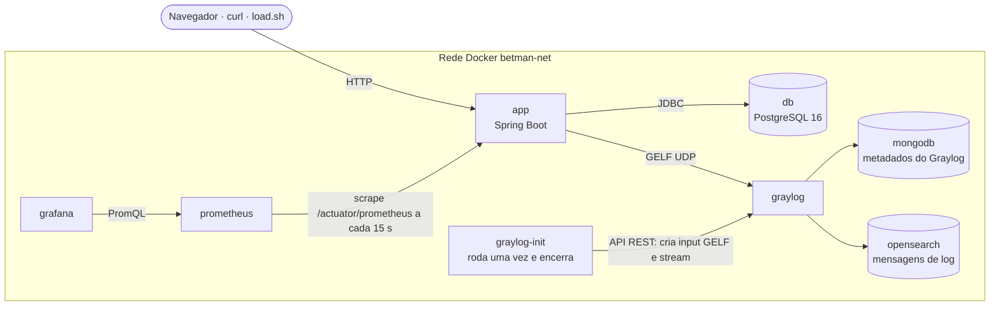

| Serviço | Imagem | Papel |
|---|---|---|
| `app` | `ghcr.io/grogww/betman` | API REST + front-end estático; expõe métricas e envia logs via GELF |
| `db` | `postgres:16-alpine` | banco da aplicação (schema e seed criados pelo Flyway) |
| `prometheus` | `prom/prometheus:v3.5.0` | coleta as métricas do app e do próprio Prometheus |
| `grafana` | `grafana/grafana:12.1.1` | datasource e dashboards provisionados por arquivo |
| `graylog` | `graylog/graylog:6.1.4` | recebe, indexa e permite buscar os logs |
| `mongodb` | `mongo:7.0.14` | guarda só os metadados do Graylog (usuários, inputs, streams) |
| `opensearch` | `opensearchproject/opensearch:2.15.0` | armazena e indexa as mensagens de log |
| `graylog-init` | `curlimages/curl:8.10.1` | cria o input GELF UDP e o stream WARN/ERROR pela API (idempotente) |

Ordem de subida garantida por `depends_on` + `healthcheck`: `db` → `app`; `prometheus` → `grafana`;
`mongodb` + `opensearch` → `graylog` → `graylog-init`.

### Entrega (CI/CD)

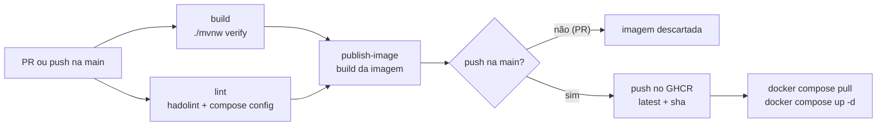

## Início rápido

Pré-requisitos: Docker com Compose v2 (`docker compose version`) e **pelo menos 6 GB de memória
disponível para o Docker** (Graylog, OpenSearch e MongoDB somam até 3,5 GB pelos `mem_limit`).
Não é preciso ter JDK, Maven nem PostgreSQL instalados: a compilação acontece dentro do Docker.

```bash
git clone https://github.com/Grogww/BetMan.git
cd BetMan
docker compose up --build
```

Esse único comando compila a aplicação pelo [Dockerfile multistage](#dockerfile-multistage), sobe
os 8 serviços na ordem certa e configura o Graylog sozinho (input GELF e stream). Não há nenhum
passo manual: o `.env` é opcional, o datasource e os dashboards do Grafana são provisionados por
arquivo e o Prometheus já começa a coletar as métricas do app.

Na primeira vez as imagens são baixadas e a stack leva de 2 a 3 minutos para ficar pronta — o
Graylog é o mais lento. Em outro terminal, acompanhe e gere tráfego:

```bash
docker compose ps               # aguarde todos os serviços ficarem "healthy"
./scripts/load.sh 10            # gera tráfego, erros e logs (Git Bash/WSL no Windows)
```

Depois disso, acesse os serviços pelas portas do [mapa abaixo](#mapa-de-portas-e-credenciais).

Não é preciso criar o `.env`: todas as variáveis têm valor padrão no compose, iguais às do
[.env.example](.env.example). Para trocar alguma, veja [Variáveis do `.env`](#variáveis-do-env).

O serviço `app` tem `build: .` e `image: ghcr.io/grogww/betman`, então dá para escolher entre o
código local e a imagem publicada pela pipeline:

| Objetivo | Comando |
|---|---|
| Compilar o código local e subir a stack (comando do enunciado) | `docker compose up --build` |
| O mesmo, em segundo plano | `docker compose up -d --build` |
| Rodar a imagem publicada no GHCR, sem compilar | `docker compose up -d` |
| Atualizar para a última imagem da `main` | `docker compose pull && docker compose up -d` |

Cada merge na `main` publica duas tags: `latest` e o sha curto do commit (ex.: `a1b2c3d`). Para
fixar uma versão, defina `BETMAN_IMAGE=ghcr.io/grogww/betman:<sha>` no `.env`.

Comandos úteis:

```bash
docker compose logs -f app      # acompanha os logs da aplicação
docker compose ps -a            # inclui o graylog-init, que encerra após configurar o Graylog
docker compose down             # para e remove os containers (os volumes de dados ficam)
docker compose down -v          # remove tudo, inclusive bancos, métricas, logs e config do Grafana
```

### Variáveis do `.env`

O `.env` é **opcional**: todas as variáveis têm valor padrão no `docker-compose.yml`, iguais aos
exemplos abaixo, e a stack sobe sem ele. Para personalizar, copie o exemplo e edite só o que quiser
trocar:

```bash
cp .env.example .env            # PowerShell: Copy-Item .env.example .env
```

> `GRAYLOG_ROOT_PASSWORD` e `GRAYLOG_ROOT_PASSWORD_SHA2` precisam corresponder à mesma senha. Se
> trocar uma, troque a outra; se divergirem, o `graylog-init` falha com `401`.

| Variável | Exemplo | Uso |
|---|---|---|
| `DB_NAME` | `betman` | nome do banco criado pelo Postgres |
| `DB_USERNAME` | `betman` | usuário do banco |
| `DB_PASSWORD` | `betman` | senha do banco |
| `DB_URL` | `jdbc:postgresql://db:5432/betman` | URL JDBC; o host é o serviço `db` |
| `APP_PORT` | `8080` | porta do app no seu computador |
| `DB_PORT` | `5433` | porta do Postgres no seu computador (evita conflito com um Postgres local) |
| `BETMAN_IMAGE` | `ghcr.io/grogww/betman:latest` | imagem da aplicação usada pelo compose |
| `SERVER_PORT` | `8080` | porta interna do container (mantenha 8080) |
| `BETMAN_LOG_LEVEL` | `DEBUG` | nível de log do pacote `com.betman` |
| `BETMAN_SIMULATION_ENABLED` | `true` | liga/desliga a simulação de eventos |
| `PROMETHEUS_PORT` | `9090` | porta do Prometheus no seu computador |
| `PROMETHEUS_RETENTION` | `7d` | tempo de retenção das métricas |
| `GRAFANA_PORT` | `3000` | porta do Grafana no seu computador |
| `GRAFANA_ADMIN_USER` | `admin` | usuário administrador do Grafana |
| `GRAFANA_ADMIN_PASSWORD` | `admin` | senha do administrador do Grafana |
| `GRAYLOG_PORT` | `9000` | porta da interface web do Graylog no seu computador |
| `GRAYLOG_GELF_PORT` | `12201` | porta UDP do input GELF no seu computador |
| `GRAYLOG_ROOT_USERNAME` | `admin` | usuário administrador do Graylog |
| `GRAYLOG_PASSWORD_SECRET` | *(16+ caracteres)* | segredo interno do Graylog — gere com `openssl rand -hex 32` |
| `GRAYLOG_ROOT_PASSWORD_SHA2` | *(SHA-256 de `admin`)* | hash da senha do admin — gere com `echo -n suaSenha \| sha256sum` |
| `GRAYLOG_ROOT_PASSWORD` | `admin` | a mesma senha em texto, usada pelo `graylog-init` para chamar a API |

## Mapa de portas e credenciais

Todas as portas abaixo são as do `.env.example`; cada uma pode ser trocada pela variável indicada
caso já esteja em uso no seu computador.

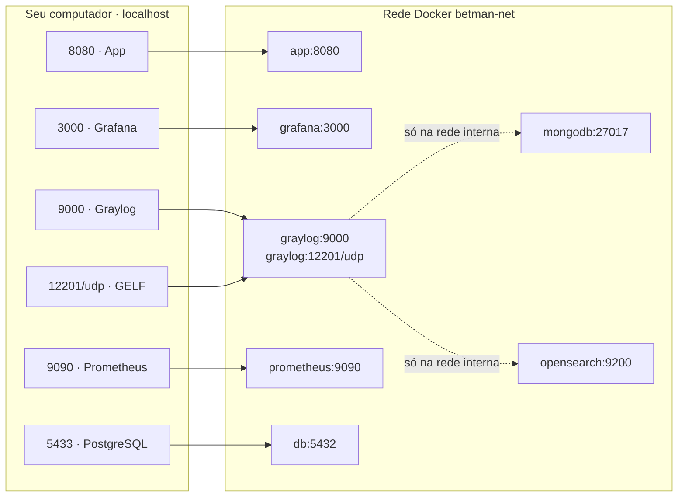

### Serviços acessíveis pelo navegador

| Serviço | Endereço | Login padrão | Variável da porta |
|---|---|---|---|
| **BetMan (app)** | <http://localhost:8080> | sem login — escolha o usuário `demo` ou crie um | `APP_PORT` |
| **Grafana** | <http://localhost:3000> | `admin` / `admin` | `GRAFANA_PORT` |
| **Graylog** | <http://localhost:9000> | `admin` / `admin` | `GRAYLOG_PORT` |
| **Prometheus** | <http://localhost:9090> | sem login | `PROMETHEUS_PORT` |

### Demais portas

| Serviço | Porta no host | Porta no container | Protocolo | Uso | Variável |
|---|---|---|---|---|---|
| PostgreSQL | `5433` | `5432` | TCP | acesso ao banco por um cliente SQL (DBeaver, psql) — `betman` / `betman` | `DB_PORT` |
| Graylog GELF | `12201` | `12201` | **UDP** | entrada dos logs; o app envia pela rede interna (`graylog:12201`) | `GRAYLOG_GELF_PORT` |
| MongoDB | — | `27017` | TCP | usado só pelo Graylog, não exposto | — |
| OpenSearch | — | `9200` | HTTP | usado só pelo Graylog, não exposto | — |

### Endereços úteis

| O que | Endereço |
|---|---|
| Health da aplicação | <http://localhost:8080/actuator/health> |
| Informações da build (versão, data do build, JVM) | <http://localhost:8080/actuator/info> |
| Métricas no formato Prometheus | <http://localhost:8080/actuator/prometheus> |
| Alvos do Prometheus (devem estar `UP`) | <http://localhost:9090/targets> |
| Consultas PromQL | <http://localhost:9090/query> |
| Dashboard BetMan · Negócio | <http://localhost:3000/d/betman-negocio> |
| Dashboard BetMan · Aplicação | <http://localhost:3000/d/betman-aplicacao> |
| Busca de logs no Graylog | <http://localhost:9000/search> |
| Streams do Graylog | <http://localhost:9000/streams> |

> As credenciais acima são **apenas para desenvolvimento local**. Para qualquer outro uso, troque
> todas as senhas e o `GRAYLOG_PASSWORD_SECRET` no `.env` (que não é versionado).

## Pipeline de CI/CD

Definida em [.github/workflows/ci.yml](.github/workflows/ci.yml).

| Gatilho | Jobs executados |
|---|---|
| Pull request para a `main` | `build` e `lint`, em paralelo; se os dois passarem, `publish-image` apenas constrói a imagem (sem push) |
| Push na `main` (merge de PR) | `build` e `lint`; se os dois passarem, `publish-image` constrói e publica a imagem |

| Job | O que faz |
|---|---|
| `build` | Java 21 (Temurin) com cache do Maven; roda `./mvnw -B verify` (compilação + testes) e publica os relatórios do Surefire como artefato `test-reports`, mesmo quando os testes falham |
| `lint` | **hadolint** no `Dockerfile` (avisos `warning` ou `error` falham o job, conforme `.hadolint.yaml`) e **`docker compose config`** duas vezes: sem `.env`, garantindo que toda variável tem valor padrão e a stack sobe sem ele, e com o `.env.example`, garantindo que o exemplo é válido |
| `publish-image` | build com Buildx (cache do GitHub Actions). Em PR, a imagem é descartada: serve para validar que o `Dockerfile` ainda compila antes do merge (o hadolint só analisa o texto). Na `main`, faz push para `ghcr.io/grogww/betman` com as tags `latest` e sha curto; autentica com o `GITHUB_TOKEN`, sem segredos extras |

Um novo push no mesmo PR cancela a execução anterior que ainda estiver rodando (`concurrency`).

Para rodar as validações do `lint` localmente:

```bash
docker run --rm -i -v "$PWD/.hadolint.yaml:/.config/hadolint.yaml" hadolint/hadolint < Dockerfile
docker compose --env-file /dev/null config --quiet   # ignora um .env local, como no CI
docker compose --env-file .env.example config --quiet
```

### Dockerfile multistage

| Estágio | Imagem base | O que faz |
|---|---|---|
| 1 · build | `maven:3.9-eclipse-temurin-21` | baixa as dependências numa camada própria (reaproveitada enquanto o `pom.xml` não muda) e gera o `.jar` |
| 2 · runtime | `eclipse-temurin:21-jre-alpine` | só o JRE e o `.jar`; roda com usuário não-root `spring`, tem `HEALTHCHECK` na readiness e dimensiona o heap pelo limite de memória do container (`-XX:MaxRAMPercentage=75.0`) |

Os testes não rodam no build da imagem: eles já são executados no job `build` da pipeline.

## Monitoramento e observabilidade

### Prometheus

Configurado em [prometheus/prometheus.yml](prometheus/prometheus.yml): coleta a cada 15 s o
endpoint `/actuator/prometheus` do app (job `betman-app`) e o próprio Prometheus. Todas as métricas
do app têm a tag `application="betman"`, e o histograma de `http.server.requests` está habilitado
para permitir o cálculo de percentis (p95).

Além das métricas padrão do Spring Boot (HTTP, JVM, Hikari), o app publica métricas de negócio:

| Métrica | Tipo | Tags | O que mede |
|---|---|---|---|
| `betman_bets_placed_total` | contador | `sport` | apostas feitas |
| `betman_bets_stake_BRL` | distribuição | `sport` | valor apostado (soma, contagem → ticket médio) |
| `betman_bets_settled_total` | contador | `result`, `sport` | apostas liquidadas, ganhas (`WON`) ou perdidas (`LOST`) |
| `betman_bets_payout_BRL` | distribuição | `sport` | prêmios pagos |
| `betman_odds_provider_latency_seconds` | timer | `outcome` | latência do provedor de odds simulado (sucesso/falha) |
| `betman_odds_provider_failures_total` | contador | — | falhas do provedor de odds |
| `betman_errors_total` | contador | `errorCode` | rejeições de negócio por código de erro |

Todas as queries PromQL usadas nos dashboards, com a explicação de cada uma, estão em
[prometheus/queries.md](prometheus/queries.md).

### Grafana

O datasource do Prometheus ([grafana/provisioning/datasources](grafana/provisioning/datasources))
e os dashboards ([grafana/dashboards](grafana/dashboards)) são **provisionados por arquivo**: sobem
prontos, na pasta **BetMan**, sem nenhuma configuração manual.

| Dashboard | Painéis |
|---|---|
| **BetMan · Negócio** | apostas, valor apostado e ticket médio no período; prêmios pagos e taxa de acerto; apostas por minuto; apostas ganhas × perdidas; liquidações ao longo do tempo; falhas e taxa de falha do provedor de odds |
| **BetMan · Aplicação** | requisições por segundo (geral, por rota e por status 2xx/4xx/5xx); total de requisições no período por status; latência p95 (geral, por rota e por status); latência média por status; taxas de erro 4xx e 5xx; uso de CPU (JVM e container); heap, threads, pausas de GC e uptime da JVM; pool de conexões Hikari |

Os dashboards ficam com `No data` até existir tráfego — rode o [script de carga](#geração-de-carga).

## Gestão centralizada de logs

A stack completa do Graylog sobe pelo compose: `graylog` (servidor e interface web), `mongodb`
(metadados) e `opensearch` (armazenamento e indexação das mensagens).

Com o profile `docker` (ativado pelo compose), o [logback-spring.xml](src/main/resources/logback-spring.xml)
envia todos os logs ao Graylog via **GELF UDP** com o appender `de.siegmar:logback-gelf`, além de
manter a saída no console. Cada linha chega como mensagem estruturada (campos separados, não texto
solto). O envio é assíncrono e descarta mensagens se a fila encher, para nunca bloquear uma
requisição.

Na subida, o serviço `graylog-init` executa os scripts de [graylog/init](graylog/init), que:

1. criam o input **BetMan GELF UDP** na porta 12201;
2. criam e iniciam o stream **BetMan WARN/ERROR**, que separa os logs `WARN` e `ERROR` do app.

Os dois scripts verificam se o recurso já existe, então podem rodar a cada `docker compose up`.

### Níveis de log

O pacote `com.betman` loga em `DEBUG` por padrão (`BETMAN_LOG_LEVEL`), então os quatro níveis
chegam ao Graylog:

| Nível | `level` (GELF) | O que gera | Exemplo |
|---|---|---|---|
| `DEBUG` | `7` | cálculo de odds, sorteio de resultados, ticks do scheduler, movimentos de carteira | `Odds calculated pHome=... oddHome=...` |
| `INFO` | `6` | usuário criado, depósito, aposta feita, evento iniciado/liquidado | `Bet placed betId=... stake=...` |
| `WARN` | `4` | rejeições de negócio e de validação (respostas 4xx) | `Request rejected errorCode=INSUFFICIENT_BALANCE status=422` |
| `ERROR` | `3` | respostas 5xx: falha do provedor de odds (503) e erros inesperados (500, com stack trace) | `Request failed errorCode=ODDS_PROVIDER_UNAVAILABLE status=503` |

Campos disponíveis em cada mensagem:

| Campo | Origem | Exemplo |
|---|---|---|
| `app` | campo fixo do appender | `betman` |
| `level_name` | nível do log | `INFO`, `WARN`, `ERROR` |
| `requestId` | `RequestContextFilter` (MDC); também volta no header `X-Request-Id` e no corpo dos erros | `3f9c1a7e-...` |
| `userId` | header `X-User-Id` da requisição (MDC) | `1` |
| `errorCode` | `GlobalExceptionHandler` (MDC), só nas rejeições | `INSUFFICIENT_BALANCE` |
| `logger_name`, `thread_name` | Logback | `com.betman.bet.BetService` |

Buscas de exemplo em <http://localhost:9000/search>:

| Busca | Resultado |
|---|---|
| `app:betman` | todos os logs da aplicação |
| `level_name:DEBUG` | logs de debug (odds, sorteios, scheduler, carteira) |
| `level_name:INFO` | eventos normais da aplicação |
| `level_name:ERROR` | respostas 5xx (provedor de odds e erros inesperados) |
| `_exists_:errorCode` | todas as respostas de erro, 4xx (`WARN`) e 5xx (`ERROR`) |
| `errorCode:INSUFFICIENT_BALANCE` | apostas recusadas por saldo insuficiente |
| `errorCode:ODDS_PROVIDER_UNAVAILABLE` | falhas simuladas do provedor de odds (503, `ERROR`) |
| `requestId:"<id>"` | todas as linhas de uma mesma requisição (copie o id da resposta de erro) |
| `userId:1` | tudo o que o usuário `demo` fez |

## Geração de carga

Com a stack no ar (`docker compose up --build`), rode em outro terminal:

```bash
./scripts/load.sh 10
```

O script cria usuários, deposita saldo, faz apostas, liquida um evento e força erros (400, 404, 409,
422 e 503 do provedor de odds ao vivo) para alimentar os dashboards do Grafana e os logs do Graylog. No Windows, rode pelo Git Bash
ou WSL.

| Parâmetro | Padrão | Descrição |
|---|---|---|
| 1º argumento | `10` | número de rodadas |
| `USERS` | `5` | quantidade de usuários criados |
| `BASE_URL` | `http://localhost:8080` | endereço da API |

Além do script, a própria aplicação gera atividade sozinha: a cada 15 s o scheduler inicia,
finaliza e liquida eventos, e o provedor de odds falha em cerca de 5% das consultas.

## Troubleshooting

**`port is already allocated` / `address already in use`**
Outra aplicação já usa a porta no seu computador. Troque a variável correspondente no `.env`
(veja o [mapa de portas](#mapa-de-portas-e-credenciais)) e rode `docker compose up -d` de novo. O
Postgres já usa `5433` por padrão para não conflitar com um Postgres local na `5432`.

**Containers reiniciando, OpenSearch ou Graylog saindo com código 137**
Falta de memória. Reserve pelo menos 6 GB para o Docker (Docker Desktop → Settings → Resources,
ou o arquivo `.wslconfig` no Windows com WSL 2).

**O app aparece como `unhealthy` ou `starting`**
A readiness inclui o banco e o healthcheck só começa a contar após 60 s. Se continuar assim,
veja `docker compose logs app` — normalmente é a senha do banco divergente entre `.env` e um volume
antigo (resolva com `docker compose down -v`).

**Não consigo entrar no Graylog, ou o `graylog-init` falha com 401**
`GRAYLOG_ROOT_PASSWORD_SHA2` precisa ser o SHA-256 exato de `GRAYLOG_ROOT_PASSWORD`. Gere o hash com
`echo -n suaSenha | sha256sum` (sem quebra de linha) e confira com `docker compose logs graylog-init`.

**Nenhum log aparece no Graylog**
1. O Graylog leva 1–2 minutos para subir; confira `docker compose ps`.
2. Rode `docker compose logs graylog-init`: deve terminar com "Input GELF UDP criado" ou "já existe".
3. Em <http://localhost:9000/system/inputs> o input **BetMan GELF UDP** deve estar `RUNNING`.
4. Gere tráfego com `./scripts/load.sh` e ajuste o intervalo da busca para "Last 5 minutes".

Os logs da subida do app podem não aparecer: o app fica pronto antes do Graylog, e mensagens UDP
enviadas antes do input existir são descartadas.

**`graylog-init` aparece como `Exited (0)`**
Comportamento esperado: ele configura o Graylog e encerra. Só vale investigar se o código de saída
for diferente de 0.

**Dashboards do Grafana com `No data`**
1. Gere tráfego com `./scripts/load.sh`.
2. Em <http://localhost:9090/targets> o alvo `betman-app` deve estar `UP`.
3. `betman_errors_total` só passa a existir depois do primeiro erro de negócio.

**A senha do Grafana não muda depois de alterar o `.env`**
O Grafana grava a senha do admin no volume `betman-grafana-data` na primeira subida e depois ignora
a variável. Redefina com
`docker compose exec grafana grafana cli admin reset-admin-password novaSenha` ou apague o volume
com `docker compose down -v`.

**`docker compose pull` falha com `denied` ou `unauthorized`**
Sem acesso à imagem no GHCR. Gere a imagem localmente com `docker compose up -d --build`.

**`./scripts/load.sh` falha no Windows com `bad interpreter` ou `\r`**
Rode pelo Git Bash ou WSL. O `.gitattributes` força final de linha LF nos `.sh`; se o clone for
anterior a ele, apague o arquivo e restaure com `git checkout -- scripts/load.sh`.

## Checklist de requisitos

Cada item do enunciado e da rubrica de avaliação, com o arquivo que o atende e a evidência.

### 0 · Multistage Build (eliminatório)

| | Requisito | Onde está |
|---|---|---|
| ✅ | Dockerfile com **Multistage Build** para gerar a imagem de produção | [Dockerfile](Dockerfile) |
| ✅ | Estágio 1 (Build): imagem com Maven/JDK para compilar e gerar o `.jar` | estágio `build` — `maven:3.9-eclipse-temurin-21` |
| ✅ | Estágio 2 (Runtime): imagem enxuta contendo apenas o JRE necessário para rodar | `eclipse-temurin:21-jre-alpine`, só o `.jar`, usuário não-root |

### Requisitos detalhados

| | Requisito | Onde está | Evidência |
|---|---|---|---|
| ✅ | **1 · Pipeline CI/CD** disparada em push e PR na `main` | [ci.yml](.github/workflows/ci.yml) — gatilhos `push` e `pull_request` | [pipeline](#pipeline-cicd-rodando) |
| ✅ | ↳ Compilação e testes | job `build` — `./mvnw -B verify` (JUnit 5, Mockito, `@WebMvcTest`) | [pipeline](#pipeline-cicd-rodando) |
| ✅ | ↳ Build da imagem com o Multistage Build | job `publish-image` — Buildx com o `Dockerfile`, em PR e na `main` | [pipeline](#pipeline-cicd-rodando) |
| ✅ | ↳ Push para um Container Registry | job `publish-image` — GHCR (`ghcr.io/grogww/betman`), tags `latest` + sha, a cada push na `main` | [GHCR](#pipeline-cicd-rodando) |
| ✅ | **2 · Monitoramento** — métricas via Actuator + Micrometer em `/actuator/prometheus` | [application.yml](src/main/resources/application.yml), `micrometer-registry-prometheus` no [pom.xml](pom.xml) | [alvos](#prometheus) |
| ✅ | ↳ Prometheus fazendo scrape contínuo do app | [prometheus.yml](prometheus/prometheus.yml) — job `betman-app` a cada 15 s | [alvos](#prometheus) |
| ✅ | **3 · Grafana** com Prometheus como datasource | [datasources/prometheus.yml](grafana/provisioning/datasources/prometheus.yml), provisionado | [dashboards](#dashboards-do-grafana) |
| ✅ | ↳ Heap da JVM | painel *Heap da JVM* — BetMan · Aplicação | [dashboards](#dashboards-do-grafana) |
| ✅ | ↳ Uso de CPU da aplicação | painel *Uso de CPU* (processo da JVM e container) | [dashboards](#dashboards-do-grafana) |
| ✅ | ↳ Requisições HTTP por segundo (RPS) | painéis *Requisições por segundo* (geral, por rota e por status) | [dashboards](#dashboards-do-grafana) |
| ✅ | ↳ Contagem e tempo de resposta por status (2xx, 4xx, 5xx) | *Total de requisições no período por status*, *Latência p95 por status*, *Latência média por status* | [dashboards](#dashboards-do-grafana) |
| ✅ | **4 · Graylog** completo (com MongoDB e OpenSearch) | [docker-compose.yml](docker-compose.yml) — `graylog`, `mongodb`, `opensearch` | [logs](#logs-no-graylog) |
| ✅ | ↳ Logs estruturados enviados via Logback + appender GELF | [logback-spring.xml](src/main/resources/logback-spring.xml), input criado por [graylog/init](graylog/init) | [logs](#logs-no-graylog) |
| ✅ | ↳ Logs de erro, info e debug visíveis e pesquisáveis | [níveis de log](#níveis-de-log) — `DEBUG`, `INFO`, `WARN` (4xx) e `ERROR` (5xx) | [logs](#logs-no-graylog) |
| ✅ | **5 · Orquestração única** com `docker compose up --build` | [docker-compose.yml](docker-compose.yml) — 8 serviços, `depends_on` + `healthcheck`, sem `.env` obrigatório e sem passo manual | [stack](#stack-no-ar) |
| ✅ | **6 · README** com instruções, decisões técnicas e evidências | este arquivo — [Início rápido](#início-rápido), [Decisões registradas](#decisões-registradas), [Evidências](#evidências) | — |

### Entregáveis

- [x] Código-fonte da aplicação Java Spring — [src](src)
- [x] `Dockerfile` configurado com Multistage Build — [Dockerfile](Dockerfile)
- [x] `docker-compose.yml` orquestrando toda a stack (App + Prometheus + Grafana + Graylog + bancos) — [docker-compose.yml](docker-compose.yml)
- [x] Configurações da pipeline em `.github/workflows` — [ci.yml](.github/workflows/ci.yml)
- [x] Arquivos de configuração do Prometheus, Grafana e Logback/GELF — [prometheus](prometheus), [grafana](grafana), [logback-spring.xml](src/main/resources/logback-spring.xml)
- [x] README completo com:
  - [x] Instruções claras de como rodar o projeto — [Início rápido](#início-rápido)
  - [x] Prints/evidências da pipeline CI/CD rodando com sucesso — [Evidências](#pipeline-cicd-rodando)
  - [x] Prints dos dashboards do Grafana exibindo os gráficos — [Evidências](#dashboards-do-grafana)
  - [x] Prints dos logs da aplicação sendo exibidos no Graylog — [Evidências](#logs-no-graylog)

### Correções após a primeira versão

Ao conferir a entrega contra o enunciado, quatro pontos foram corrigidos:

| PR | Correção | Requisito |
|---|---|---|
| [#24](https://github.com/Grogww/BetMan/pull/24) | O compose passou a ter valor padrão para todas as variáveis: `docker compose up --build` sobe sem criar o `.env`. O `lint` valida o compose também sem `.env` para o problema não voltar | 5 · Orquestração única, sem intervenção manual |
| [#25](https://github.com/Grogww/BetMan/pull/25) | Dashboard **BetMan · Aplicação** completado com uso de CPU, threads, GC, uptime e HTTP por status (RPS, contagem, latência p95 e média para 2xx, 4xx e 5xx) | 3 · Grafana |
| [#26](https://github.com/Grogww/BetMan/pull/26) | Respostas 5xx passaram a ser logadas em `ERROR` (as 4xx continuam em `WARN`), e o script de carga passou a chamar as odds ao vivo para gerar os 503 do provedor | 4 · Graylog — logs de erro visíveis |
| [#27](https://github.com/Grogww/BetMan/pull/27) | A imagem Docker passou a ser construída também nos PRs (sem push), não só na `main` | 1 · Pipeline — build da imagem a cada push ou PR |

## Evidências

### Pipeline CI/CD rodando

Execução na `main` com os jobs `build`, `lint` e `publish-image` concluídos com sucesso:

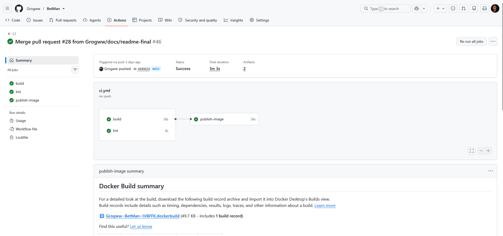

Imagem publicada no GHCR com as tags `latest` e sha:

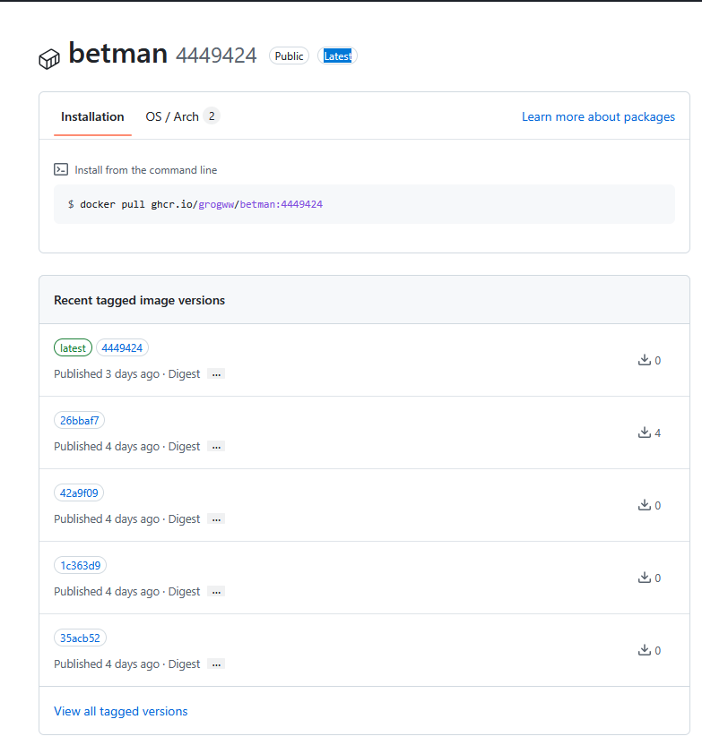

### Stack no ar

Os 8 serviços após `docker compose up --build`, todos `healthy` (o `graylog-init` encerra com
`Exited (0)` depois de configurar o Graylog):

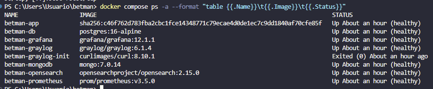

### Prometheus

Alvos `betman-app` e `prometheus` com estado `UP`:

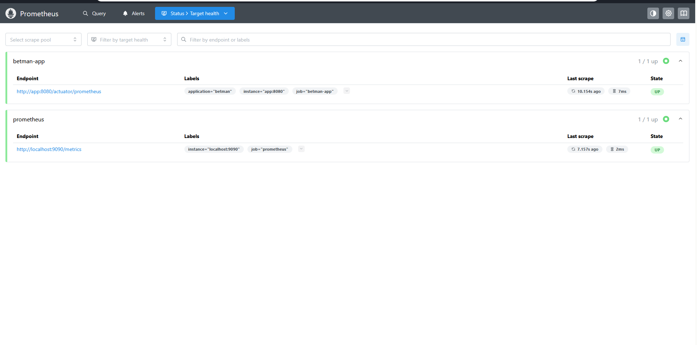

### Dashboards do Grafana

**BetMan · Aplicação** — RPS, contagem e latência por status (2xx, 4xx, 5xx), CPU, heap, threads,
GC e pool de conexões:

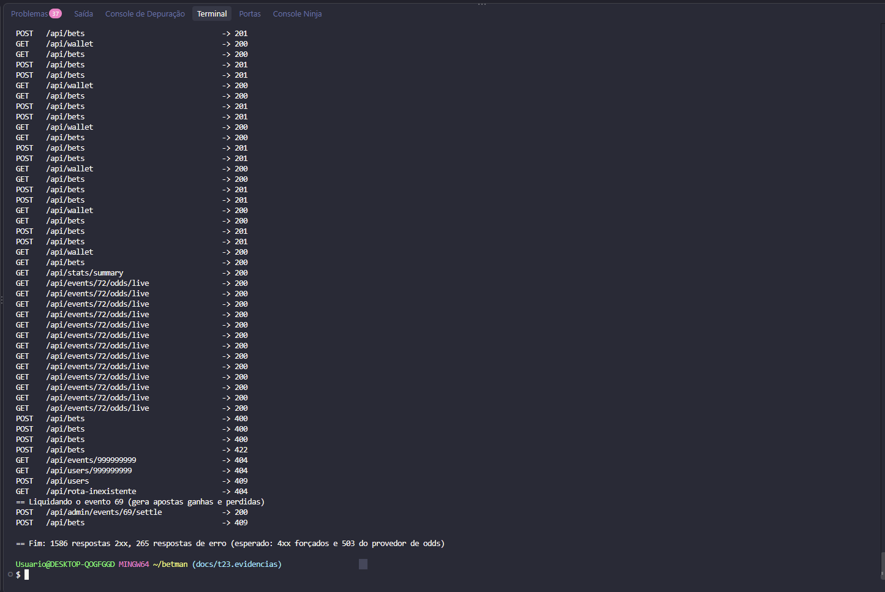

**BetMan · Negócio** — apostas, valores, liquidações e falhas do provedor de odds:

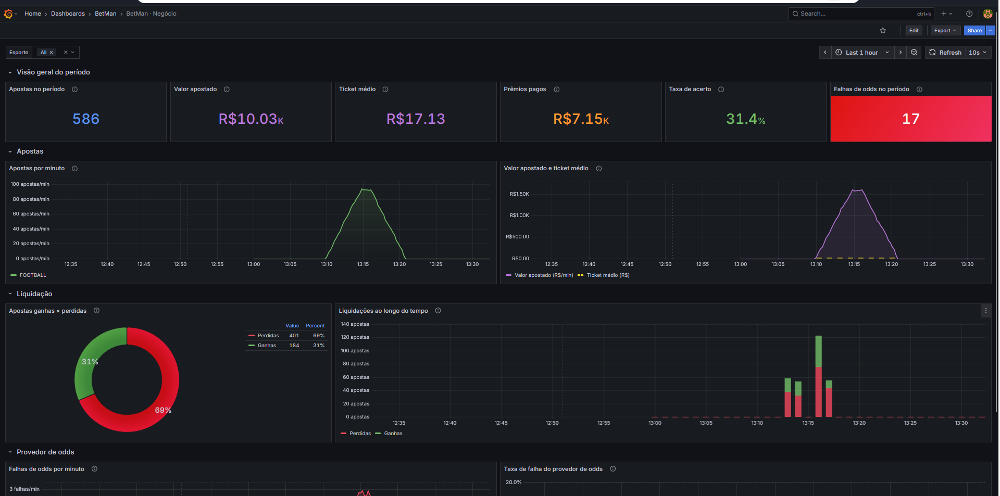

### Logs no Graylog

Busca `app:betman` com logs `DEBUG`, `INFO`, `WARN` e `ERROR` e os campos `requestId`, `userId` e
`errorCode`:

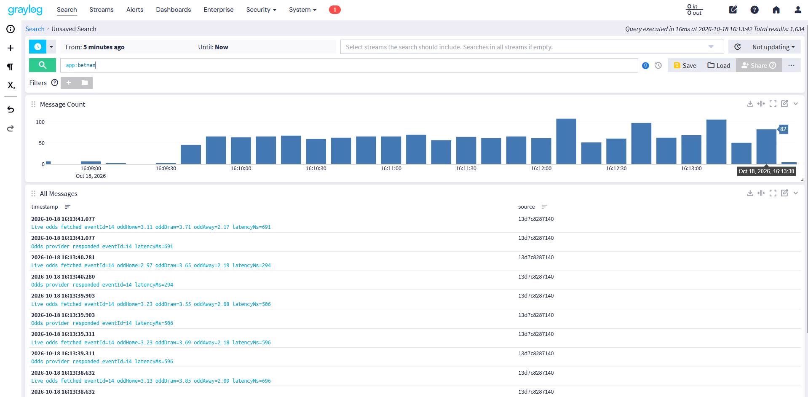

Busca `level_name:ERROR` com as falhas 503 do provedor de odds:

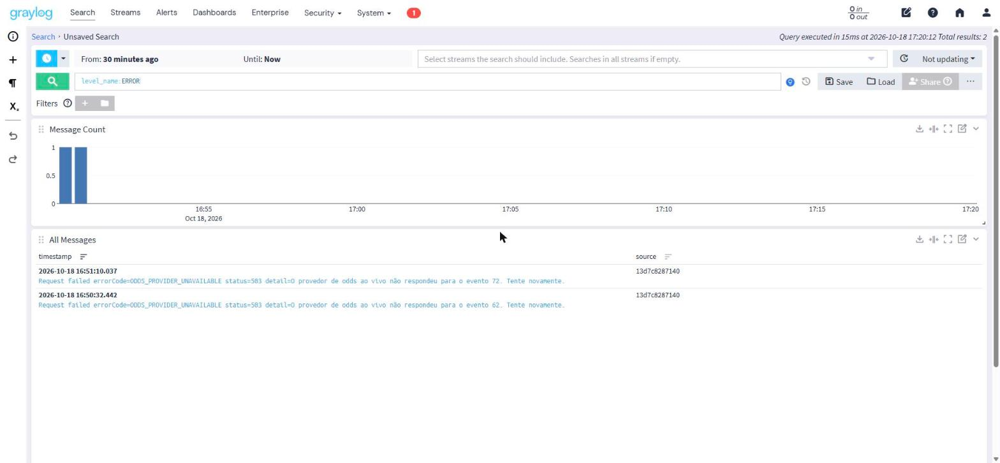

Stream BetMan WARN/ERROR:

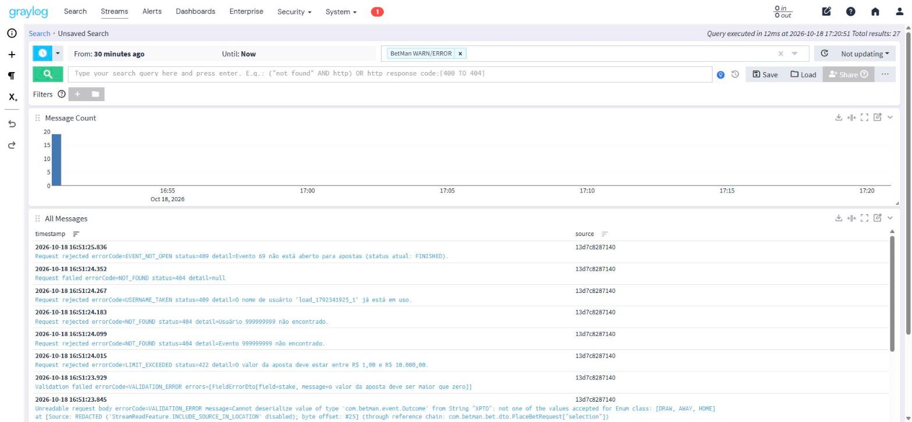

## Rodar sem Docker

Útil para desenvolver a aplicação. Nesse modo os logs vão só para o console (o envio ao Graylog é
do profile `docker`).

### Pré-requisitos

- JDK 21+ (`java -version`)
- PostgreSQL 16+ rodando localmente (porta padrão `5432`)
- Nada mais: o Maven vem pelo wrapper (`./mvnw` / `mvnw.cmd`)

### Criação do banco

```sql
-- psql -U postgres
CREATE ROLE betman WITH LOGIN PASSWORD 'betman';
CREATE DATABASE betman OWNER betman;
```

O schema e os dados de demonstração são criados pelo Flyway na primeira subida
(`src/main/resources/db/migration`):

- `V1__create_schema.sql` — tabelas, FKs, checks e índices;
- `V2__seed_demo_data.sql` — usuário `demo` com saldo `1000.00` e 6 eventos agendados.

### Variáveis de ambiente

| Variável | Padrão | Descrição |
|---|---|---|
| `DB_URL` | `jdbc:postgresql://localhost:5432/betman` | URL JDBC |
| `DB_USERNAME` | `betman` | usuário do banco |
| `DB_PASSWORD` | *(vazio)* | senha do banco |
| `SERVER_PORT` | `8080` | porta HTTP |
| `BETMAN_LOG_LEVEL` | `DEBUG` | nível de log do pacote `com.betman` |
| `BETMAN_SIMULATION_ENABLED` | `true` | liga/desliga o scheduler de eventos |

Os demais parâmetros (`betman.simulation.*`, `betman.odds-provider.*`, `betman.limits.*`) estão em
`src/main/resources/application.yml` e podem ser sobrescritos por argumento
(ex.: `--betman.odds-provider.failure-rate=0.2`) ou pelas variáveis equivalentes do Spring
(`BETMAN_ODDSPROVIDER_FAILURERATE=0.2`).

### Como rodar

```bash
export DB_PASSWORD=betman      # PowerShell: $env:DB_PASSWORD = "betman"
./mvnw spring-boot:run          # Windows: mvnw.cmd spring-boot:run
```

Abra <http://localhost:8080>. Na primeira visita escolha o usuário `demo` ou crie um novo
(ganha bônus de boas-vindas). A cada 15 s o scheduler inicia, finaliza e liquida eventos e repõe a
lista de jogos agendados — em 2–3 minutos as apostas mudam de status sozinhas.

### API

Rotas com prefixo `/api`; o header `X-User-Id` é obrigatório nas rotas de carteira e apostas:

```bash
curl -s localhost:8080/api/events?status=SCHEDULED
curl -s -X POST localhost:8080/api/bets -H 'X-User-Id: 1' -H 'Content-Type: application/json' \
     -d '{"eventId": 1, "selection": "HOME", "stake": 25.00}'
curl -s localhost:8080/api/events/1/odds/live      # latência aleatória e 503 ocasionais
curl -s -X POST localhost:8080/api/admin/events/1/settle -H 'Content-Type: application/json' \
     -d '{"result": "HOME"}'
curl -s localhost:8080/api/stats/summary
```

Erros seguem RFC 9457 (`application/problem+json`) com `errorCode` e `requestId`; o mesmo id
volta no header `X-Request-Id` e aparece nos logs como `req=` (e no campo `requestId` do Graylog).

| `errorCode` | Status | Quando |
|---|---|---|
| `VALIDATION_ERROR` | 400 | corpo, parâmetro ou header inválido |
| `NOT_FOUND` | 404 | usuário, evento ou rota inexistente |
| `USERNAME_TAKEN` | 409 | nome de usuário já utilizado |
| `EVENT_NOT_OPEN` | 409 | aposta em evento que não está aberto |
| `EVENT_ALREADY_SETTLED` | 409 | liquidação de evento já finalizado |
| `CONCURRENT_UPDATE` | 409 | conflito de atualização simultânea da carteira |
| `INSUFFICIENT_BALANCE` | 422 | saldo insuficiente |
| `LIMIT_EXCEEDED` | 422 | valor fora dos limites de aposta, depósito ou saque |
| `ODDS_PROVIDER_UNAVAILABLE` | 503 | falha simulada do provedor de odds |
| `INTERNAL_ERROR` | 500 | erro inesperado |

## Como testar

```bash
./mvnw clean verify
```

Os testes (unitários com JUnit 5 + Mockito + AssertJ e de controller com `@WebMvcTest`)
**não dependem de PostgreSQL nem de Docker**: usam `Clock.fixed(...)`, `RandomGenerator` com seed
fixa e `@MockitoBean`. São os mesmos executados pelo job `build` da pipeline.

## Decisões registradas

- **Projeto na raiz do repositório.** O Initializr gerou o projeto na raiz, e o código, o
  `Dockerfile`, o compose e as configurações da stack ficaram lado a lado, sem subpastas por serviço.
- **`RandomGenerator` = `java.util.Random`.** É thread-safe (o scheduler e as requisições
  compartilham a instância) e continua sendo substituível por `new Random(seed)` nos testes.
- **Relacionamentos como `Long` (`userId`, `eventId`, `walletId`)** em vez de `@ManyToOne`.
  Evita lazy loading com `open-in-view: false` e mantém entidades e testes simples; as FKs estão
  no schema do Flyway. A listagem de apostas carrega os eventos em lote (`findAllById`).
- **Existência do usuário checada no `@CurrentUser`.** O `HandlerMethodArgumentResolver` valida o
  header (400) e consulta `UserService.ensureExists` (404), deixando os controllers limpos.
- **Rejeições de negócio logadas no `GlobalExceptionHandler`** (WARN com `errorCode`), evitando
  logs duplicados nos services. O provedor de odds também loga sua própria falha simulada com a
  latência, por ser o principal gerador de erros para a observabilidade.
- **Odds opcionais no `POST /api/admin/events`.** Se qualquer uma faltar, as três são geradas pelo
  `OddsCalculator`. `startsAt` no passado é aceito (o evento entra `LIVE` no próximo tick), útil
  para demonstrações.
- **`POST /api/admin/events/{id}/settle` devolve o evento + resumo** (`wonBets`, `lostBets`,
  `totalPaid`) para a tela de simulação.
- **`type` do `ProblemDetail`.** O Spring 7 omite `"type": "about:blank"` na serialização; pela
  RFC 9457 a ausência equivale a `about:blank`.
- **Mockito como agente Java no Surefire** (`maven-dependency-plugin:properties` +
  `-javaagent`), conforme recomendado para JDK 21+.
- **Testes fora do build da imagem.** O Dockerfile usa `-DskipTests`: os testes já rodam no job
  `build`, e o `publish-image` só executa depois dele passar.
- **`build` e `image` juntos no serviço `app`.** `docker compose up --build` compila o código local
  pelo Dockerfile multistage (o comando do enunciado), e `docker compose up -d` sem `--build` usa a
  imagem já publicada no GHCR. Nenhum dos dois exige JDK na máquina.
- **Valores padrão em todas as variáveis do compose** (`${VAR:-padrão}`). A stack sobe de primeira
  sem `.env`; o `lint` da pipeline roda `docker compose config` sem `.env` para garantir isso.
- **Ordem de subida por `healthcheck`, não por tempo.** Cada serviço só sobe quando as dependências
  respondem (`condition: service_healthy`), então não há `sleep` nem reinício manual.
- **Imagem construída em todo PR, publicada só na `main`.** O PR valida que o `Dockerfile` e o
  `pom.xml` ainda geram a imagem antes do merge, sem poluir o registry com imagens não aprovadas.
- **Configuração do Graylog por script, não por volume.** Input e stream são criados pela API no
  `graylog-init`, de forma idempotente, em vez de depender de um dump do MongoDB.
- **4xx em `WARN`, 5xx em `ERROR`.** Rejeições de negócio são esperadas (saldo insuficiente,
  validação) e não devem parecer falhas; só o que é falha do servidor sai como `ERROR`, o que deixa
  a busca `level_name:ERROR` e o stream WARN/ERROR úteis para investigar problemas reais.
- **GELF via UDP e assíncrono.** Uma falha ou lentidão do Graylog nunca afeta as requisições; em
  troca, mensagens podem ser perdidas se o Graylog estiver fora.
- **`numbersAsString` no GELF.** Mantém o tipo dos campos estável no OpenSearch (ex.: `userId`
  sempre string), evitando conflitos de mapeamento.
- **Séries de negócio registradas em zero na subida.** Assim `rate()`/`increase()` contam desde a
  primeira aposta e os painéis não começam vazios.

## Estrutura do repositório

```
.
├── .github/workflows/ci.yml        # pipeline: build, lint e publicação no GHCR
├── Dockerfile                      # build multistage (Maven/JDK → JRE alpine)
├── docker-compose.yml              # stack completa: app, db, Prometheus, Grafana, Graylog
├── .env.example                    # variáveis do compose (copiar para .env)
├── .hadolint.yaml                  # regras do lint do Dockerfile
├── prometheus/
│   ├── prometheus.yml              # alvos de scrape
│   └── queries.md                  # queries PromQL dos dashboards
├── grafana/
│   ├── provisioning/               # datasource Prometheus e provider de dashboards
│   └── dashboards/                 # BetMan · Negócio e BetMan · Aplicação (JSON)
├── graylog/init/                   # scripts que criam o input GELF e o stream WARN/ERROR
├── scripts/load.sh                 # gerador de carga
├── docs/img/                       # prints das evidências
└── src/
    ├── main/resources/
    │   ├── application.yml         # configuração do app, Actuator e métricas
    │   ├── logback-spring.xml      # console + GELF (profile docker)
    │   ├── db/migration/           # Flyway: schema e seed
    │   └── static/                 # index.html, css/betman.css, js/api.js, js/app.js
    └── main/java/com/betman/
        ├── config/                 # @ConfigurationProperties (records), Clock, RandomGenerator, @EnableScheduling
        ├── common/
        │   ├── error/              # ErrorCode, exceções de domínio, GlobalExceptionHandler (ProblemDetail)
        │   ├── money/              # arredondamento HALF_EVEN e formatação R$
        │   └── web/                # RequestContextFilter (MDC), @CurrentUser, paginação
        └── user/  wallet/  event/  odds/  bet/  settlement/  simulation/  admin/  stats/
```
